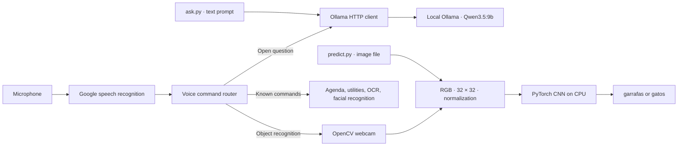

# AURA — Multimodal AI Assistant

AURA is a Python desktop assistant developed by Levi Prandi de Oliveira as an individual academic project during Deep Learning coursework at FIAP. It combines a locally hosted text model, a two-class image classifier trained for the project, and a voice-driven command router. The terminal entry points demonstrate text generation and image classification independently of the microphone and webcam.

## Architecture



| Feature | Implementation | Validation in this distribution |
| --- | --- | --- |
| Text generation | Pretrained Qwen3.5:9b served by Ollama over loopback HTTP | Real terminal request |
| Image classification | Project-trained PyTorch CNN with two convolutional layers. Pillow and torchvision apply the original preprocessing. | CPU inference with the included historical weights on a synthetic image. Automated tests also check both label mappings using temporary weights. |
| Voice and command routing | SpeechRecognition and Google's external speech service for transcription, pyttsx3 for speech output, and keyword rules for known commands | Router tested with mocks. Microphone and speech output were outside the validation. |
| Agenda and utilities | Local text agenda, date and time, arithmetic, jokes and application shortcuts | Routing tested for representative commands. The calculator shortcut targets Windows. |
| Camera features | OpenCV for webcam input and Haar face detection, EasyOCR pretrained models for Portuguese and English OCR, and an LBPH recognizer historically fitted to local samples | Historical features. Camera, OCR and facial recognition were outside the hardware validation. The public facial module displays numeric IDs and requires a compatible, authorized local LBPH model. |

## Setup

Tested with **Python 3.12.16 on macOS arm64**. Run the commands from this directory. If `python3.12` is outside your `PATH`, use the path to that executable. The pinned core requirements cover image inference and tests. The text CLI uses the Python standard library.

```sh
python3.12 -m venv .venv
source .venv/bin/activate
python -m pip install --only-binary=:all: -r requirements.txt
python -m pip check
```

### Ask the local model

Start Ollama separately and make sure `qwen3.5:9b` is already installed. The client connects to `http://127.0.0.1:11434`. Set `AURA_OLLAMA_MODEL` to select a different installed model. Ollama and its model weights are external prerequisites.

```sh
python ask.py "Explain how a convolutional neural network processes an image."
```

### Classify an image

The repository includes the historical CNN checkpoint, `reconhecedor_objetos_pytorch.pth`. After cloning and installing the core dependencies, run the following command with a local image. The loader reads the checkpoint on CPU with `weights_only=True`.

```sh
python predict.py --image path/to/image.jpg
```

Replace the example path with an image you are authorized to use. The output is one of two labels. Index `0` is `garrafas` (bottles) and index `1` is `gatos` (cats). The classifier always selects one of these labels, including for images outside the training classes. A prediction on a synthetic image verifies execution. Accuracy remains unmeasured here.

You can generate a synthetic input to exercise the CLI with the included checkpoint.

```sh
python -c 'from PIL import Image; Image.new("RGB", (65, 48), (50, 150, 200)).save("aura-smoke.png")'
python predict.py --image aura-smoke.png
```

### Run the tests

The tests use synthetic images and temporary weights for CNN checks, and mocks for the service and peripheral routes. They run without the historical checkpoint, Ollama, a microphone or a camera.

```sh
python -m unittest discover -s tests -v
```

### Optional voice and vision dependencies

For `python assistente_voz.py`, install SpeechRecognition, PyAudio with PortAudio, and pyttsx3 in the virtual environment. The wake word is `assistente`. Voice input requires a microphone and access to Google's speech recognition service. Agenda commands create a local `agenda.txt` file.

Camera commands require GUI-capable OpenCV. Facial recognition needs `opencv-contrib-python` and a compatible `classificadorLBPH.yml` obtained with authorization. OCR needs EasyOCR and separately provisioned detection and recognition weights. The public OCR code disables automatic weight downloads. Configure these dependencies only for the features you use.

## Academic attribution and licensing

Levi Prandi de Oliveira is the author of the original project code. That code is released under the MIT License. See [LICENSE](LICENSE).

PyTorch, torchvision, Pillow, Ollama, Qwen, OpenCV, EasyOCR and the speech dependencies remain subject to their respective licenses and attribution requirements.
